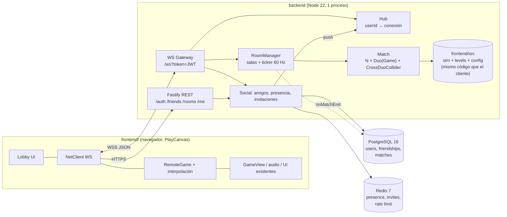
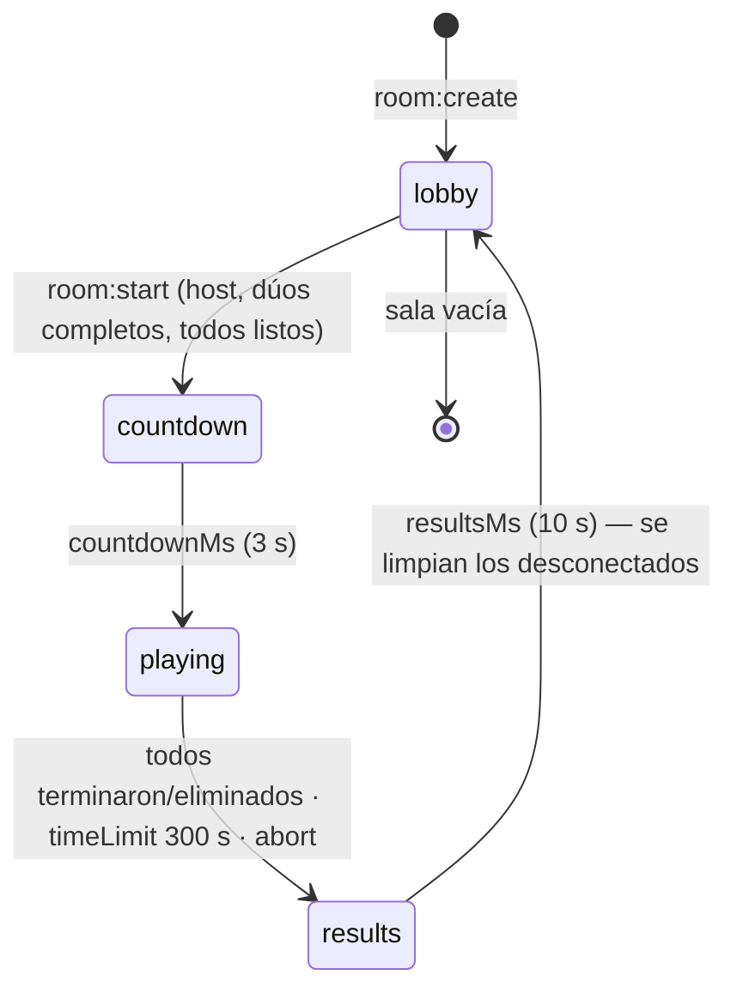
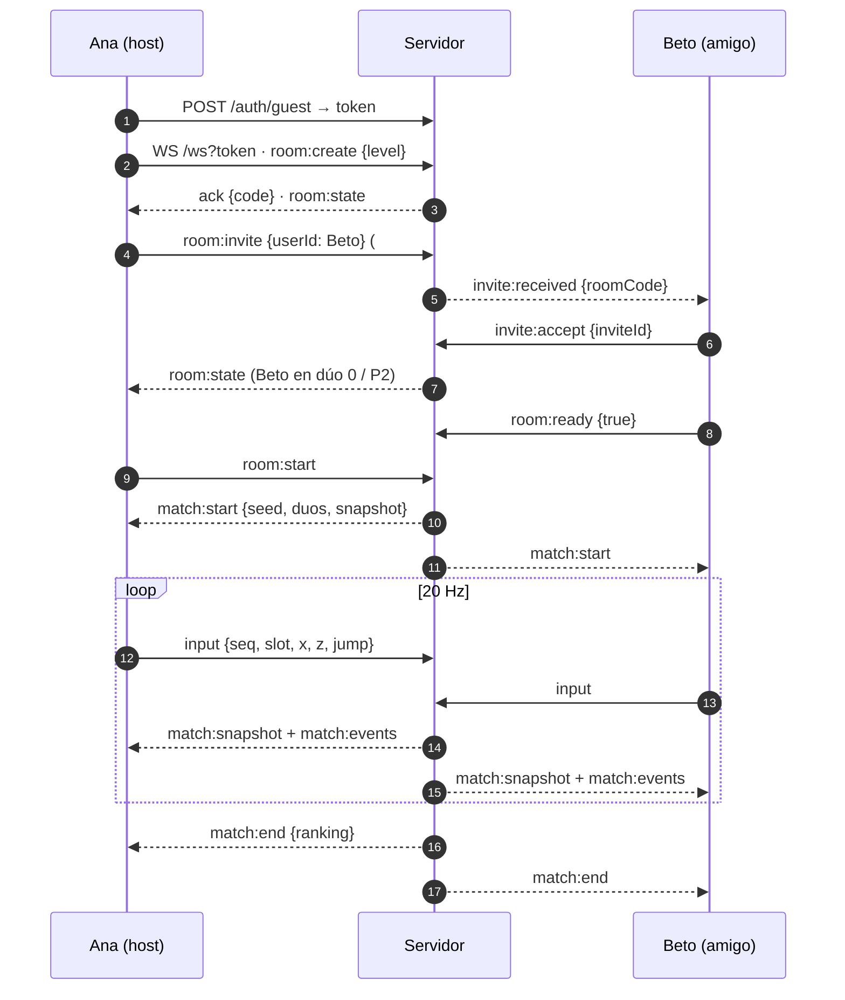

# SDD — Backend online de Hold the Box

> Software Design Document. Versión 1.0 · 2026-11-04 · Equipo backend: **Danel** ([@danelmott](https://github.com/danelmott)) y **Turriago** ([@turriago](https://github.com/turriago)).
> Contrato de mensajes: [`PROTOCOL.md`](./PROTOCOL.md). Tareas: épica #2 (issues #3–#18).

## 1. Contexto y objetivo

`frontend/` (en **este mismo repo**, traído desde `Jgmaza/hold-the-box` @ `8ce517d`) es un juego PlayCanvas **coop local 2P**: dos jugadores cargan **una caja** frágil (inclinación, huequito, mojado, gato, bomba) por un nivel con agua, rodillos, NPCs y clima.

Objetivo: llevarlo **online, estilo Stumble Guys**:

- Varias **parejas (dúos)** en el mismo mapa, en tiempo real, compitiendo por llegar primero a la meta.
- Cada jugador ve **todo lo que les pasa a los demás**: se les cae la caja, se caen al agua, pierden vidas, los empujan.
- **Colisiones entre jugadores** de distintos dúos: empujones y golpes que sacuden la caja del otro.
- **Salas** con código para jugar con amigos y **social**: añadir / eliminar amigos, invitar a un amigo a tu sala.
- Lo más **rápido** posible: latencia baja en el loop y en el stack de datos.

### Alcance MVP (milestone “MVP online”)
Salas por código, dúos (incluido dúo de sofá), partida autoritativa con colisiones entre dúos, snapshots + eventos, invitado con apodo, cuentas, amigos, invitar amigo a sala, cliente online en `frontend/`.

### Fuera de alcance (por ahora)
Anti-cheat avanzado, varios procesos/regiones, tienda, inventario, ranking global online.

## 2. Decisiones clave

| # | Decisión | Por qué |
|---|---|---|
| D-1 | **Servidor autoritativo que corre la MISMA simulación** de `frontend/src/sim` | La sim es JS puro, sin DOM ni PlayCanvas, determinista por semilla (`new Game(level, {seed})`). Cero reescritura de física; el servidor no se puede “desincronizar” del juego. Medido: ~0,06 ms por paso y dúo. |
| D-2 | **Node 22 + JS ESM** (sin TypeScript) | Importa la sim tal cual. JSDoc + zod para tipos/validación. |
| D-3 | **Fastify 5** (REST) + **ws 8** (WebSocket) en el mismo puerto | `ws` es el WebSocket más rápido y estable en Node sin dependencias nativas; Fastify es el framework HTTP más rápido de Node. Socket.IO/Colyseus añaden capas que no necesitamos. |
| D-4 | **Estado de partida y salas en memoria** del proceso | El tick (60 Hz) no puede esperar I/O. Microsegundos vs. milisegundos. |
| D-5 | **Redis 7** para lo efímero | Presencia con TTL, invitaciones con TTL, índice código-sala, rate limit. Sub-ms, y prepara el escalado a varios procesos. |
| D-6 | **PostgreSQL 16 + Drizzle ORM** para lo durable | Usuarios, amistades (relación N:N con restricciones), historial. SQL relacional = integridad (únicos, FK, checks) y consultas simples de amigos. Drizzle: ligero, SQL explícito, migraciones en código. |
| D-7 | **JSON** en el MVP, binario después | Depurable con cualquier herramienta; ~2–4 KB por snapshot con 8 dúos. Delta + binario en la issue de optimización. |
| D-8 | **Sin predicción** en el MVP; interpolación 100 ms | El resorte de la caja acopla a los dos jugadores; predecir bien es difícil. Primero que funcione; predicción del dúo local como issue p2. |
| D-9 | **Un `Game` por dúo + capa de colisión entre dúos** | Reutiliza `Game` intacto (vidas, checkpoints, caja). Lo compartido (colisiones jugador-jugador) vive en `backend/src/match/collisions.js`. Mundo compartido (vidrio, NPCs) llega en una issue. |
| D-10 | **Monorepo**: juego (`frontend/` + `deliveries/`) y servidor (`backend/src/`) en el mismo repo | El servidor importa la sim directamente de `frontend/src` (vía `backend/src/game/index.js`): cliente y servidor corren exactamente el mismo código, sin copias que sincronizar. Un cambio en la sim y su efecto online van en el mismo PR. `gameVersion` = `GIT_SHA` del deploy (o versión de `frontend/package.json`). |

## 3. Arquitectura



### Carpetas

```
package.json              atajos para los dos lados (dev:backend, dev:frontend, test, build:frontend, bots)
frontend/                 el juego (PlayCanvas + Vite)
  src/sim/ src/levels/ src/config.js   simulación pura: la ejecutan el navegador Y el backend
  src/net/duoState.js     codec del estado por dúo (backend serializa, cliente vuelca)
  src/characterIds.js     ids de personajes (puro, lo valida el backend)
  src/view/ src/ui/       PlayCanvas, menú, HUD (solo navegador)
  test/  public/  scripts/
backend/                  el servidor
  src/
    index.js              arranque
    app.js                buildApp(): Fastify + plugins + rutas + gateway (inyección de dependencias)
    config/env.js         variables de entorno
    errors.js             AppError(code, message, status)
    auth/routes.js        /auth/guest|register|login|refresh|logout|upgrade · /me
    auth/tokens.js        JWT de acceso + refresh rotatorio (solo su sha256 en BD)
    users/                MemoryUserRepo (sin BD) · PgUserRepo (con DATABASE_URL)
    ws/
      gateway.js          upgrade + JWT, router, heartbeat. Acepta `handlers` extra (social) sin tocarlo
      protocol.js         schemas zod C→S
      hub.js              registro de conexiones; sendTo / broadcast
      connection.js
    rooms/
      room.js             modelo de sala (sin I/O)
      roomManager.js      salas, partidas, ticker, envío por destinatario
      codes.js
    match/
      match.js            lockstep, fin, ranking
      duo.js              Game de la sim + input latch + estado del dúo
      collisions.js       choques entre dúos (Stumble Guys)
      snapshot.js         snapshot (usa frontend/src/net/duoState.js)
      events.js           eventos que se reenvían
    game/index.js         única puerta a la sim (importa de frontend/src)
    db/                   Drizzle: schema, client, migrate (#3)
    redis.js              cliente ioredis, prefijo htb: (#3)
    social/               friendsRepo (Pg + memoria) · friendsService (reglas + push) · friendsRoutes (#5)
                          presence.js: estado derivado de hub + salas, Redis con TTL (o memoria) (#6)
                          invites.js + invitesRoutes.js: invitar a sala / unirse a amigo, Redis con TTL (o memoria) (#7)
                          matchHistory.js + historyRoutes.js: guardar partidas en onMatchEnd, historial y stats (#8)
  test/  tools/bots.mjs  .env.example
deliveries/               assets del equipo que usa el juego (audio, modelos .glb, paleta) — el frontend los lee como ../deliveries
docs/                     SDD.md · PROTOCOL.md
```

## 4. Tiempo real

### 4.1 Loop

- **Ticker único** (`RoomManager._ensureTicker`): `setInterval` a `TICK_HZ=60`, mide `dt` real y llama `match.advance(dt)` de todas las partidas.
- Dentro, acumulador a **paso fijo `CONFIG.physics.fixedStep` = 1/120 s** (el mismo del cliente) → 2 pasos de sim por vuelta.
- `selectBox(boxProfile)` antes de simular cada partida: `CONFIG.box` es global en la sim; como JS es de un hilo, fijarlo por partida es suficiente.
- Por paso: `duo.step()` para cada dúo → `collider.resolve()` → condiciones de fin.
- Cada `1/SNAPSHOT_HZ` (20 Hz): `flush()` → `match:events` (si hay) + `match:snapshot`.
- Presupuesto: < 4 ms por vuelta con 2 salas × 8 jugadores (medido ~2 ms con `backend/tools/bots.mjs`).

### 4.2 Input

- Cliente manda `input { seq, slot, x, z, jump, jumpHeld }` a ~30 Hz o al cambiar.
- `Duo.setInput` descarta `seq` viejos; `jump` se **latchea** (`jumpPending`) y se consume en el siguiente paso → nunca se pierde un salto aunque llegue entre ticks.
- Slot desconectado → input neutro (el compañero sigue, la caja se resiente: es parte del juego).
- **Nunca** se llama `setInputs` a un dúo en `won`/`failed` (la sim reinicia con salto).

### 4.3 Estado de partida visible para todos

**Codec compartido** `frontend/src/net/duoState.js` (JS puro, lo importan servidor y cliente):

- `lightDuoState(game)` → jugadores, caja completa, gato, bomba y datos de HUD (vidas, checkpoint, `respawnTimer`, `runTime`). Va para **todos** los dúos en cada snapshot.
- `worldDuoState(game)` → el mundo que vive ese dúo: NPCs y disparos, clima por zona, vidrios rotos, estaciones, cactus. Va **solo** a los jugadores de ese dúo (`own`), porque hasta #13 cada dúo tiene su propio mundo.
- `applyLightDuoState` / `applyWorldDuoState` → el cliente los vuelca sobre un `Game` local (mismo nivel y semilla) que **no simula**. Así `GameView`, `UI` y `GameAudio` leen los mismos objetos que en local, sin adaptadores. Test de ida y vuelta en `frontend/test/netDuoState.test.js` (4 mapas × 3 cajas): si alguien añade a la sim estado que la vista lee y no lo mete en el codec, el test lo delata.

Envío (`RoomManager._sendSnapshot`): la parte común se serializa **una vez**; a cada jugador se le añade el `own` de su dúo (≈3 KB común + 0,6 KB `own` con 4 dúos).

Eventos: lo “narrativo” (`box:drop`, `game:splash`, `game:life`, `game:checkpoint`, `player:bump`, `duo:finished`…) llega a **todos** con el `duo` de origen → “¡A los azules se les cayó la caja!”. Lo que solo afecta al HUD/audio propio (`PRIVATE_EVENTS`: clima, bomba, gato, estaciones, `box:wet`) va **solo a ese dúo**; `recovery:tick` y `box:wet` se agrupan por snapshot.

Personajes: `room:setChars { p1?, p2? }` (ids validados con `frontend/src/characterIds.js`); `match:start` trae `char` y `alt` por jugador.

Lado cliente (`frontend/src/net/`, #12): un `Game` sin simular por dúo (`OnlineMatch`); render ~100 ms por detrás interpolando jugadores y caja; el dúo propio se dibuja con `GameView` y los demás con `GameView.addDuo` (2 `PlayerView` + `BoxView`); los eventos se disparan en el `game.events` de su dúo cuando el render llega a su tiempo `t`. Probado de punta a punta con el cliente real en Node (`backend/test/client.e2e.test.js`) y en Chromium.

### 4.4 Colisiones entre dúos (Stumble Guys)

`backend/src/match/collisions.js` — `CrossDuoCollider.resolve(duos, time, emit)`:

1. Cuerpos = jugadores de dúos `racing`, en `playing`, sin reaparecer.
2. Pares de **dúos distintos**, solapados en XZ (`radio + radio`) y en altura (`< height`).
3. **Fantasma**: si alguno tiene `ghost > 0` (2 s tras aparecer/reaparecer) o la pareja ya estaba marcada, se ignora hasta que se separen (spawns compartidos sin explosiones).
4. Separación: cada uno se mueve la mitad del solape con `player.move()` (respeta colisiones del nivel).
5. Golpe: si la velocidad de acercamiento > `minSpeed` (1,5 m/s) y pasó el `cooldown` (0,4 s): fuerza = `clamp(closing × gain, min, max)`; el que más empuja es el atacante → `target.knock()` + retroceso al atacante + `box.kick()` a la caja del golpeado + evento `player:bump`.

Dentro del mismo dúo manda la sim original (`sim/carry.js`). Mejoras (masa, caja-caja, tuning) en la issue de colisiones v2.

### 4.5 Ciclo de vida de sala y partida



Dúo: `waiting → racing → finished | eliminated`.

**Reconexión y espectadores (#14):** al cortarse, el miembro queda `online: false` durante `RECONNECT_GRACE_MS` (30 s) sin perder su puesto; si no vuelve, en lobby sale de la sala y en partida queda `abandoned` (input neutro) y sale al terminar. Los espectadores (`role: 'spectator'`, sin puesto, máx. 8) entran con `room:spectate` incluso en partida, no bloquean el `room:start` y eligen qué dúo mirar con `match:watch`; `RoomManager._viewTeam` decide de qué dúo recibe cada uno el `own` y los eventos privados. **Ranking**: llegados por tiempo; luego checkpoint (desc) y distancia a la meta (asc).

### 4.6 Secuencias



## 5. Datos

### 5.1 Qué va dónde (por velocidad)

| Dato | Dónde | Latencia | Vida |
|---|---|---|---|
| Partida (posiciones, caja, inputs) | Memoria del proceso | µs | Lo que dura la partida |
| Salas / lobby | Memoria (+ índice `room:{code}` en Redis al escalar) | µs | Hasta vaciarse |
| Presencia (online / en sala / en partida) | Redis `presence:{userId}` TTL 60 s | <1 ms | Mientras haya heartbeat |
| Invitaciones a sala | Redis `invite:{id}` TTL 120 s | <1 ms | 2 min |
| Rate limit | Redis | <1 ms | ventana |
| Usuarios, amistades, solicitudes | PostgreSQL | ~1–5 ms | Permanente |
| Historial de partidas | PostgreSQL (escritura asíncrona en `onMatchEnd`) | fuera del tick | Permanente |

### 5.2 Esquema PostgreSQL (Drizzle, `backend/src/db/schema.js`)

```sql
create extension if not exists citext;

create table users (
  id            uuid primary key default gen_random_uuid(),
  username      citext unique,                 -- null en invitados
  display_name  text not null check (char_length(display_name) between 3 and 16),
  password_hash text,                          -- argon2id; null en invitados
  is_guest      boolean not null default true,
  created_at    timestamptz not null default now(),
  last_seen_at  timestamptz
);
-- username: ^[a-z0-9_]{3,16}$ (validado en app)

create type friend_request_status as enum ('pending','accepted','declined','cancelled');

create table friend_requests (
  id           uuid primary key default gen_random_uuid(),
  from_user_id uuid not null references users(id) on delete cascade,
  to_user_id   uuid not null references users(id) on delete cascade,
  status       friend_request_status not null default 'pending',
  created_at   timestamptz not null default now(),
  responded_at timestamptz,
  check (from_user_id <> to_user_id)
);
create unique index friend_requests_pending_uq
  on friend_requests (least(from_user_id,to_user_id), greatest(from_user_id,to_user_id))
  where status = 'pending';

create table friendships (            -- una fila por pareja, user_a < user_b
  user_a     uuid not null references users(id) on delete cascade,
  user_b     uuid not null references users(id) on delete cascade,
  created_at timestamptz not null default now(),
  primary key (user_a, user_b),
  check (user_a < user_b)
);
create index friendships_b_idx on friendships (user_b);

create table refresh_tokens (
  id         uuid primary key default gen_random_uuid(),
  user_id    uuid not null references users(id) on delete cascade,
  token_hash text not null unique,
  expires_at timestamptz not null,
  revoked_at timestamptz
);

create table matches (
  id          uuid primary key,
  room_code   text not null,
  level       text not null,
  box_profile text not null,
  seed        bigint not null,
  reason      text not null,             -- allDone | timeLimit | aborted
  duration_s  real not null,
  started_at  timestamptz not null,
  ended_at    timestamptz not null default now()
);

create table match_results (
  match_id    uuid not null references matches(id) on delete cascade,
  user_id     uuid not null references users(id) on delete cascade,
  team_id     smallint not null,
  slot        smallint not null check (slot in (1,2)),
  placement   smallint not null,
  status      text not null,             -- finished | eliminated | dnf
  finish_time real,
  rating      text,
  integrity   smallint, wetness smallint,
  primary key (match_id, user_id, slot)
);
create index match_results_user_idx on match_results (user_id, match_id);
```

### 5.3 Claves Redis

| Clave | Tipo | TTL | Contenido |
|---|---|---|---|
| `presence:{userId}` | hash | 60 s (refresco por heartbeat / cambio) | `status`, `roomCode`, `updatedAt` |
| `invite:{inviteId}` | hash | 120 s | `fromId`, `toId`, `roomCode`, `createdAt` |
| `invites:to:{userId}` | zset | 120 s | inviteIds por `expiresAt` |
| `rl:{scope}:{key}` | string/counter | ventana | rate limit |
| `room:{code}` | string | mientras viva | id del proceso dueño (cuando haya >1 proceso) |

## 6. Social

- **Amigos**: solicitud por `username` → aceptar/rechazar/cancelar → amistad simétrica (`friendships`, `user_a < user_b`). Eliminar amigo borra la fila. Invitados (`isGuest`) **no** pueden tener amigos: tienen que hacer `POST /auth/upgrade`.
- **Push en vivo**: el módulo social usa `hub.sendTo(userId, …)` → `friend:request`, `friend:accepted`, `friend:removed`, `friend:presence`, `invite:received`. Si el destinatario no está conectado, lo verá al pedir `GET /friends/requests`.
- **Invitar amigo a sala**: solo amigos; la invitación vive 120 s en Redis; aceptarla hace `room:join` por el usuario. Alternativa “unirse a la sala de un amigo” si su presencia es `in_lobby`.
- **Interacciones en partida**: choques (sección 4.4) y emotes (issue p2).

## 7. Seguridad y robustez

- JWT HS256 (`JWT_SECRET` obligatorio en producción), acceso 7 d en MVP → acceso 15 min + refresh 30 d con cuentas.
- Validación zod de **todo** mensaje WS; payload WS máx. 4 KB, body REST máx. 16 KB.
- Rate limit (#9): REST por IP (`@fastify/rate-limit` + Redis `rl:rest:`): 100/min global y 10/min para todo `/auth/*`. WS por conexión (`ws/rateLimit.js`, token bucket): `input` 90/s (ráfaga 120, se descarta), control 20/s (ráfaga 40, `RATE_LIMITED`), 5 s seguidos de exceso → cierre 4008. Upgrades: 3/s por IP, tope `MAX_CONNECTIONS` (503), `Origin` validado si `CORS_ORIGIN` no es `*`. En desarrollo, 127.0.0.1 no tiene límites por IP (bots y tests).
- Cabeceras con `@fastify/helmet` (sin CSP: es un API). Logs pino con `reqId` y `userId`; se tapan `authorization`, `password`, `token`, `refreshToken` y el `?token=` de las URLs.
- El servidor es autoritativo: el cliente solo manda intención (`x`, `z`, `jump`), nunca posiciones.
- Backpressure: snapshots se descartan si el socket tiene >1 MB pendiente; eventos y estados no.
- Una conexión por usuario (la nueva reemplaza con 4001).
- Errores con código estable (`backend/src/errors.js`); nunca stack traces al cliente.

## 8. Requisitos no funcionales

| Métrica | Objetivo MVP |
|---|---|
| Tick del servidor (2 salas × 8 jug.) | < 4 ms promedio |
| Snapshots | 20 Hz estables por cliente |
| Latencia percibida (misma región) | < 150 ms input → ver movimiento |
| Jugadores por sala | hasta 16 (8 dúos) |
| Arranque local | `npm run install:all && npm run dev:backend` sin Docker (MVP); con Docker cuando entren Postgres/Redis |
| Tests | `npm test` verde en CI en cada PR a `dev` |

## 9. Despliegue

- 1 contenedor Node (Dockerfile multi-stage) + Postgres + Redis gestionados. Proveedor recomendado: **Fly.io** (WebSocket nativo, región cercana a los jugadores) o Railway.
- WSS detrás del TLS del proveedor; el cliente usa `VITE_SERVER_URL`.
- CI: GitHub Actions con servicios postgres/redis → `npm test`.
- Detalle en la issue de deploy y `docs/DEPLOY.md`.

## 10. Flujo de trabajo

- Ramas: `main` (prod) ← `dev` (integración) ← `work/danel` · `work/turriago`.
- Cada uno trabaja en su `work/*` (sincronizada con `dev`) y abre un PR a `dev` por issue con `Closes #n`. Tests y `docs/PROTOCOL.md` actualizados en el mismo PR.
- `dev → main` cuando el MVP esté jugable.

## 11. Reparto

| Área | Dueño | Issues |
|---|---|---|
| Plataforma y social (BD, Redis, cuentas, amigos, presencia, invitaciones, historial, seguridad, deploy) | **Turriago** | #3 #4 #5 #6 #7 #8 #9 #10 |
| Tiempo real y juego (colisiones, cliente online en `frontend/`, mundo compartido, reconexión, matchmaking, red, predicción, emotes) | **Danel** | #11 #12 #13 #14 #15 #16 #17 #18 |
| Núcleo MVP | hecho | PR #1 |

Puntos de contacto entre los dos: `hub.sendTo` (social → WS), `handlers` extra del gateway, `RoomManager.onMatchEnd` (historial), `UserRepo` (cuentas). Ver cada issue.
